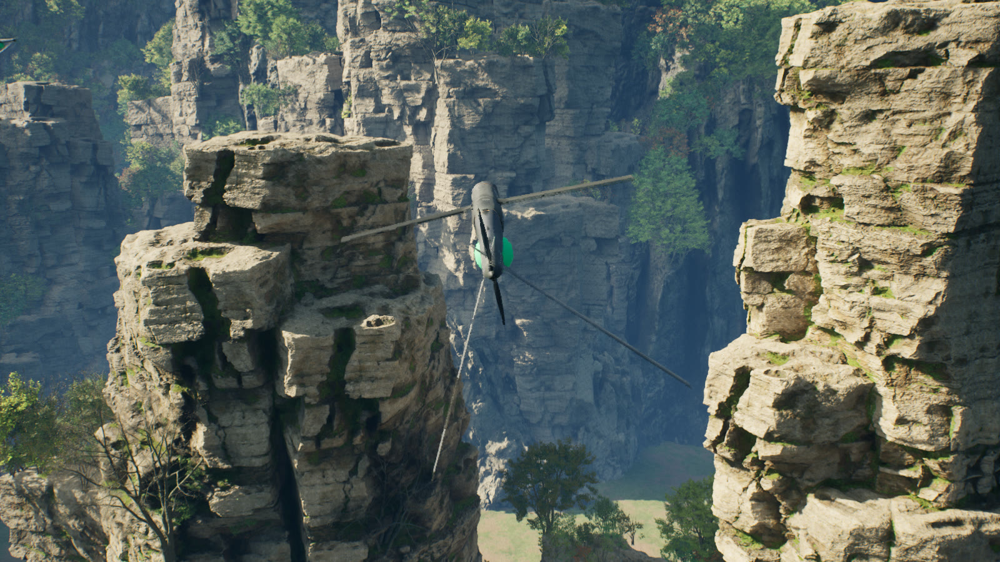
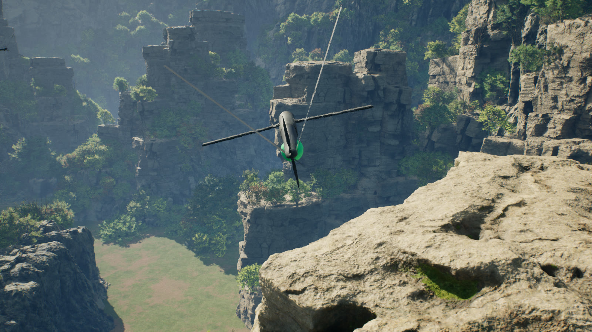
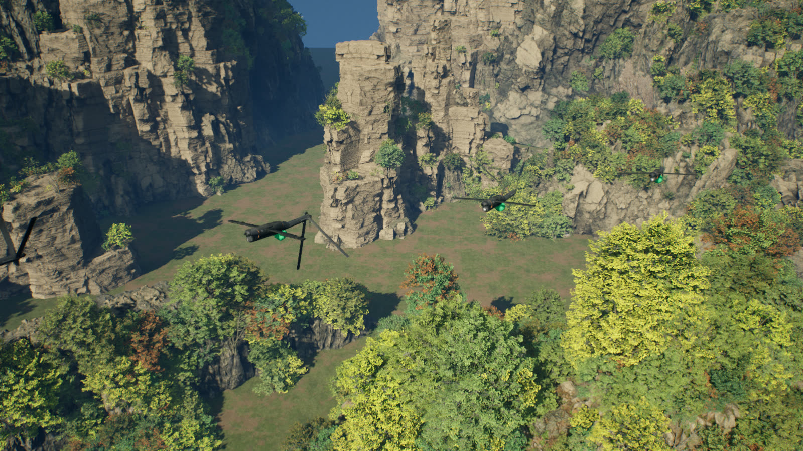

# SwarmSim

Deterministic C++17 simulation and benchmark for drone-swarm behavior under degraded communication and perception: bursty packet loss, jamming, weather-degraded sensing, neighbor state prediction, and a fallback state machine. It simulates two vehicles, a quadrotor and an ALTIUS-class fixed-wing aircraft, with wind, an energy-based flight model, terrain-aware altitude guidance, and flight patterns. Runs are reproducible from a seed. An Unreal Engine 5.4 plugin plays recorded runs back as a presentation.

[](https://github.com/evanpetersen919/SwarmSim/actions/workflows/ci.yml) [](LICENSE)



One of five aircraft on a tight orbit, seen from the viewer's follow camera as it flies between two rock pillars. A scratch scenario fitted to a 2 km export of a premade level (5 aircraft, 120 m radius, terrain guidance on, seed 7); it is not in the repository. The aircraft is drawn 2.5 times its size so that it reads at this distance.



The same run a few seconds later, banking past a cliff edge with a clearing below.



Four aircraft in formation over the same level. This is a scratch variant of [scenarios/fixed_wing_formation.yaml](scenarios/fixed_wing_formation.yaml) fitted to the level (4 aircraft, seed 7). The simulation never renders anything; the viewer only reads the log. See [Credits](#credits) for the level and the aircraft model.

## Status

What exists, by area. [docs/PLAN.md](docs/PLAN.md) has the scope and the dated change log, and [docs/PHASES.md](docs/PHASES.md) the order of work.

- **Deterministic runtime.** A fixed-step clock, seeded random streams, a message channel with latency, random and burst loss, jitter, a rate limit, and jamming zones, a lockstep thread pool, a per-tick state hash, and a binary run log that can be verified by re-execution.
- **Vehicles.** A point-mass quadrotor with an IMU and a LiDAR whose range depends on weather. An ALTIUS-class fixed-wing aircraft with two flight models (a coordinated-turn point mass, and an energy model with thrust, drag, roll lag, and a stall limit), a steady wind with gusts, and a camera position fix. An optional radar altimeter (ADR 0012).
- **Estimation and control.** A Kalman pose estimator, neighbor reports, three neighbor predictors (hold last state, dead reckoning, Kalman), a drone brain with consensus formation, separation, and a fallback state machine, and for the fixed-wing aircraft orbit, racetrack, lanes, and formation patterns (trail, echelon, vee, rake) with terrain-aware altitude guidance.
- **Scenarios and metrics.** Runs are described by strict, versioned scenario files and measured from their logs: formation or path error, separation, collisions, recovery time, message latency and delivery ratio, height above ground and ground contacts, exported as CSV. A scenario can run with its messages over real UDP and TCP sockets on loopback and writes the same log as the simulated run.
- **Experiments.** Experiment files expand into a matrix of cells that `swarm_batch` runs in parallel into a table that does not depend on the job count. A Python package summarizes the table with intervals and figures.
- **Unreal viewer.** A plugin that builds a scene from a log and plays it back, or plays a log in a premade level. It is checked by automation tests and by eye locally, not by CI.

## Results

There are no benchmark results to report yet. The fixed-wing experiments of ADR 0010 (see [docs/phases/fixed-wing-vehicle.md](docs/phases/fixed-wing-vehicle.md)) were run before the energy model, wind, and terrain guidance existed, so they do not describe the current model, and the 30-seed fixed-wing runs and the quadrotor matrix have not been run. Every number that goes here will come from `swarm_batch` on a file in [experiments/](experiments/), with the hardware, compiler, commit, and seed count named.

## Build and run

Requirements: CMake 3.22 or newer and a C++17 compiler (gcc, clang, or MSVC).

```sh
cmake --preset release
cmake --build --preset release
ctest --preset release
```

Presets for sanitizer builds are `asan-ubsan` and `tsan` (GCC or Clang). See [CMakePresets.json](CMakePresets.json). Setup notes for Windows and Unreal are in [docs/DEVELOPMENT.md](docs/DEVELOPMENT.md).

Run a scenario, write its log, and compute metrics from the log:

```sh
./build/release/apps/swarm_sim run scenarios/fixed_wing_formation.yaml --out run.swlog
./build/release/apps/swarm_sim metrics run.swlog
```

The same seed gives the same log for any thread count (`--threads N`) on the same platform. Run a batch of cells with `swarm_batch experiments/smoke.yaml --out results/smoke.csv --jobs 4`, and see [docs/DEVELOPMENT.md](docs/DEVELOPMENT.md) for the Python analysis. `swarm_sim --help` lists every option, including the placeholder-agent runner that records and verifies a log:

```sh
./build/release/apps/swarm_sim --record run.log --seed 42 --agents 16 --ticks 500 \
  --loss-model burst --loss 0.2 --mean-burst 4 --latency 2 --jitter 2 --threads 1
./build/release/apps/swarm_sim --replay run.log --verify --threads 8
```

```
recorded 500 ticks to run.log
verified run.log: all recorded hashes match
```

To see a run in Unreal, write the scene with `swarm_sim export-scene run.swlog --out scene.swscene`, or start the game in a level with `-SwarmLog=run.swlog`. The options and the commands are in [docs/DEVELOPMENT.md](docs/DEVELOPMENT.md) and [docs/MODELS.md](docs/MODELS.md).

Docker: `docker build -t swarmsim . && docker run --rm swarmsim`.

## Design

Each tick runs in a fixed order: deliver messages, sense, estimate, decide, send. Drone logic runs on a thread pool and all threads meet at a barrier at the end of the tick. Messages are delivered in order of simulation time, then sender id, so thread scheduling does not change the result. Models are chosen through interfaces from the scenario file, and metrics are computed from logs, not inside the simulation.

Determinism comes from a single fixed-step simulation clock, seeded random streams per subsystem, ordered message delivery, and no wall-clock reads in the core. It is not guaranteed across different compilers, optimization flags, or CPU architectures that change floating-point behavior.

| Component | What it does | Location |
|---|---|---|
| Format | Run log, scene data, and replay reader; no Eigen or yaml-cpp, and no exceptions, because it is also compiled into the plugin | [core/format/](core/format/) |
| Simulation core | Clock, thread pool, vehicles, sensors, comms model, estimation, control | [core/sim/](core/sim/) |
| Scenarios and metrics | Scenario files, the world builder, the runner, and metrics from logs | [core/scenario/](core/scenario/) |
| Experiments | Experiment files and the batch driver | [core/experiment/](core/experiment/) |
| Network backend | Wire protocol and a UDP/TCP channel with the same interface as the simulated one | [net/](net/) |
| Apps | `swarm_sim`, `swarm_batch`, `swarm_bench`, `swarm_netcmp` | [apps/](apps/) |
| Unreal plugin | Builds a scene from a log and plays logs back; visualization only | [ue5-plugin/](ue5-plugin/) |
| Analysis | Python scripts that turn CSV metrics into figures and tables | [analysis/](analysis/) |

More detail: [docs/PLAN.md](docs/PLAN.md), [docs/ARCHITECTURE.md](docs/ARCHITECTURE.md), [docs/DETERMINISM.md](docs/DETERMINISM.md), [docs/MODELS.md](docs/MODELS.md), and the decision records in [docs/decisions/](docs/decisions/).

## The fixed-wing aircraft

The aircraft is "ALTIUS-class", not a model of any real aircraft. Its parameters live in files and each is marked in [docs/MODELS.md](docs/MODELS.md) as published, from the literature, or assumed. For the ALTIUS-600 the press figures used are the mass (about 12 kg), the wingspan (2.54 m), and a 60 km/h cruise and 90 km/h maximum speed. Everything else is assumed: the wing area, the drag polar, thrust, power, roll rate, the camera position fix, the radar altimeter, and the flight patterns, because public sources do not describe them. [scenarios/fixed_wing_rake.yaml](scenarios/fixed_wing_rake.yaml) uses ALTIUS-700-class figures (cruise 33 m/s, maximum 51 m/s, mass 28.5 kg) supplied without a source and not checked against a datasheet. Results are for the simulator and for these parameter sets.

## Testing

Tests use GoogleTest and are grouped as unit, determinism, and integration under [tests/](tests/); `tests/property/` is empty. Run `ctest -N` for the list. CI builds with gcc and clang on Linux in release and with AddressSanitizer and UBSan, builds with ThreadSanitizer, builds the core as C++20 (the Unreal plugin compiles `core/format` that way), runs a determinism job that records on one thread and verifies on eight, checks formatting with clang-format, and runs the Python tests. `scripts/check_core_invariants.sh` enforces the rules for `core/` (no wall-clock time or unseeded randomness, and estimators that never read the simulated truth).

Not covered by CI: the Unreal plugin, which needs a local UE 5.4 install, and the MSVC build.

## Limitations

- The weather models are parametric degradations. They are not fitted to or validated against real sensor data, apart from one published visibility curve.
- Packet loss and jamming are modeled at the message level, not as a physical radio channel.
- The neighbor predictor is a Kalman filter with a constant-velocity assumption and degrades under maneuvers.
- The quadrotor's pose comes from a LiDAR-derived position fix, and the fixed-wing aircraft's from an assumed camera position fix. Neither is full localization, and how the real aircraft navigates without GPS is not public.
- The fixed-wing aircraft's terrain handling is vertical only: it raises its altitude (from a prior map, and with the altimeter from a measurement) but does not turn or slow down for terrain, so ground that rises faster than the aircraft can climb still catches it.
- The flight patterns are standard ones chosen as assumptions. A lawnmower sweep with turns is not modeled; the rake flies one pass.
- Performance numbers will come from one machine.
- There is no flight testing, hardware-in-the-loop, or autopilot integration.

## Repository layout

```
core/         simulation library (no Unreal dependency)
  format/       run log, scene data, replay reader (also compiled into the plugin)
  sim/          clock, channel, vehicles, sensors, estimation, control
  scenario/     scenario files, world builder, runner, metrics
  experiment/   experiment files and the batch driver
net/          wire protocol and UDP/TCP channel
apps/         command-line programs
ue5-plugin/   Unreal Engine 5.4 plugin
UnrealHost/   minimal Unreal project that hosts the plugin
scenarios/    scenario definitions (YAML)
experiments/  experiment definitions (YAML)
analysis/     Python analysis scripts
tests/        unit, determinism, integration tests
docs/         plan, architecture, models, decisions, phase notes
```

## Credits

The viewer's aircraft is the model "Anduril ALTIUS 700M" by KillCaptureDestroy, licensed CC-BY-4.0. It is not stored in the repository. The screenshots show a premade Unreal level, the Electric Dreams Environment, which is not stored in the repository either. Its licence was not checked for this README, and the screenshots are the only part of it shown here; they will be removed if its terms do not allow them.

## Related work

Swarm-LIO2 (decentralized LiDAR-inertial swarm odometry) and ns-3 based UAV co-simulators such as CORNET and FANS cover nearby ground. This project differs in focus: a seeded, replayable benchmark of how prediction and fallback behavior hold up under burst loss and degraded sensing.

## License

MIT. See [LICENSE](LICENSE).
